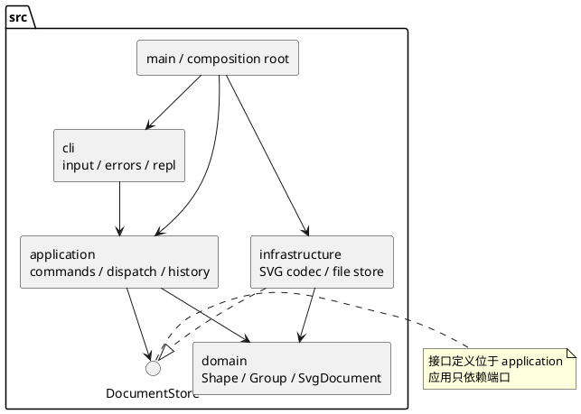

# Lab 1 Phase 1：SVG 编辑器（CLI）

本项目以课程文件 `phase_cli_1.md` 为功能和提交要求，使用 Codex 协作实现。本文记录实际架构方案、实施决策、关键迭代和验证结果。

## 一、架构方案

### 1. 模块划分与职责

| 目录 | 职责 | 主要对象 |
|---|---|---|
| `src/domain/` | 图形对象、几何与样式规则、容器树、id 唯一性、分组和顺序规则 | `Shape`、`GeometryShape`、六种图形类、`ShapeFactory`、`SvgDocument`、`SvgNumber` |
| `src/application/` | 用例编排、Command、命令注册、会话状态、事务草稿、历史屏障、显示格式和存储端口 | `Command`、`EditCommand`、`CommandRegistry`、`EditorSession`、`CommandHistory`、`DocumentStore`、`TreeRenderer` |
| `src/cli/` | 输入解析、逐行执行、统一错误边界和终端交互 | `Tokenizer`、`CliEngine`、`CliApplication` |
| `src/infrastructure/` | SVG XML 编解码、外部变换归一化、Node 文件读写 | `SvgCodec`、`SvgTransform`、`NodeDocumentStore` |
| `src/main.ts` | 实例装配、启动入口 | 组合根 |
| `test/` | 领域、存储、命令与进程级验收 | Node 内置测试 |
| `tools/` | 架构依赖与类结构的静态检查 | `ArchitectureCheck` |
| `examples/` | 可回放的命令脚本和可直接预览的 SVG | 流程图、综合示例、外部导入样例 |

组件图采用 PlantUML，箭头表示源码依赖方向：



### 2. 设计模式的选择及落地

**Command（必须项）**：`Command` 定义执行协议，每条命令由独立类承担。编辑命令继承 `EditCommand`，实现针对文档的操作；`CommandRegistry` 根据命令名创建命令对象，执行入口面向抽象协议。`CommandHistory` 持有已成功执行的编辑命令，调用其 `undo` / `redo`，而非按字符串重新解释历史。

**Composite**：抽象 `Shape` 统一规定 `move`、`scale`、`setAttribute`、`clone`、`describe` 等行为。矩形等叶子类完成自身几何计算；`Group` 持有封装的子节点并递归转发移动、缩放。应用层处理 `move node2 ...` 时无须判断节点是否为某种叶子。删除容器删除整棵子树，创建时 `in`、事后 `group` 和 `addto` 共用文档树规则。

`set g fill red` 设置容器自身的 SVG 继承属性，不主动覆盖子节点已显式设置的 fill；与浏览器 SVG 继承一致。`box` 的自定义传播和便利属性属于下一阶段。

**Memento + Template Method**：`EditCommand.execute` 固定执行流程：保存前态 → 深克隆草稿 → 调用具体命令的操作 → 保存后态 → 提交新文档并登记历史。任一步验证失败，草稿被丢弃，当前文档和 undo/redo 栈不变。撤销和重做通过深拷贝的前后快照恢复完整树与顺序；具体命令只实现业务差异。

选择整文档快照是因为本阶段文档规模小、容器操作复杂，正确性比增量压缩更重要。代价是每个历史单元占用 O(N) 文档内存；未来大文档可将快照替换成局部补丁，不改变 CLI 语法和 Command 协议。

**Factory / Registry**：`ShapeFactory` 将六种类型注册到构造器及参数元数据；命令注册表将命令名映射到类。图形在工厂创建之后通过多态完成行为，XML 编码遍历统一接口，不按六种 tag 分别拼装逻辑。

**依赖倒置**：`DocumentStore` 在 application 定义，`EditorSession` 通过构造器接收端口。`NodeDocumentStore` 实现真实文件 IO；测试可注入内存替身，无须访问磁盘。

**明确的待重构边界**：本阶段仅在 `CommandRegistry` 与 `ShapeFactory` 两处集中按名字选择实现。这两处内置注册仍写在源码里，后续插件化时要改为接收外部 `CommandProvider` / `ShapeProvider`。当前只保留清晰边界，没有提前实现插件加载、动态导入或 `box`。

### 3. 依赖方向规则

| 来源模块 | 允许依赖 | 理由 |
|---|---|---|
| domain | domain 内部 | 几何与树规则不依赖终端、XML 或文件系统 |
| application | application、domain | 用例调用领域对象，通过自有端口请求 IO |
| cli | cli、application；必要的 Node 终端 API | 终端适配应用，不越层改领域对象，不构造文件存储 |
| infrastructure | infrastructure、domain、application 的 `DocumentStore` 端口 | 适配器还原领域对象并实现端口，不依赖命令和 CLI |
| main | 所有业务模块及 Node 启动 API | 唯一组合根负责选择实际实现 |
| test / tools | 被测模块、Node 测试 API、TypeScript 编译器 API | 测试和检查位于产品依赖图之外 |

额外规则：domain/application 不引用 Node 内置模块或第三方包；每个类独占一个同名 `.ts` 文件；图形分派不得散落为 `switch(tag)`。`ArchitectureCheck` 遍历 TypeScript AST 检查层依赖、单类同名文件以及是否出现 switch；它不能替代语义设计审查。

### 4. 变化点假设

| 可能变化 | 本阶段的准备 | 暂不实现的理由 |
|---|---|---|
| 增加图形类型、复合图形、插件 | `Shape` 多态协议；类型名选择集中在 `ShapeFactory` | 课程明确将 `box` 和 ShapeProvider 放在后续阶段，不假设已满足“内核零修改”的插件目标 |
| 新增编辑命令或输入通道 | Command 协议、独立具体命令、可注入会话 | GUI / agent 可以调用应用层；本阶段只实现 CLI，不预建 GUI 事件系统 |
| 更换持久化方式 | `DocumentStore` 端口和 XML 适配器 | 网络、数据库、本地文件的差别不进入领域模型 |
| 支持更多 SVG 特性 | XML 边界集中在 `SvgCodec` / `SvgTransform` | 任意 path、CSS、滤镜、旋转等会显著扩大几何与渲染模型，当前明确拒绝不支持结构 |
| 大文档历史性能 | 历史与命令接口集中；前后状态由命令所有 | 暂用完整快照保证树结构恢复正确，不提前引入复杂的增量补丁 |
| 输出格式、本地化 | `describe`、`TreeRenderer` 和命令反馈有明确责任边界 | 当前中文内容与 SVG 往返有效；不为未要求的多语言资源系统增加层级 |

## 二、过程记录

以下为本次 AI 协作中真实发生的关键决策，日期为 2026-11-02。最初方案保留在 `PLAN.md`，分步实现记录保留在 Git 历史。

| 阶段 | 发现的问题或风险 | 采取的决策及可核查证据 |
|---|---|---|
| 需求识别 | 作业介绍包含 `box` 的完整示例，容易把未来阶段误作当前必做项 | 对照 4.4 阶段边界，当前只注册六种类型；CLI 测试验证 `create box` 返回指定未知类型错误 |
| 模块设计 | 同时实现领域、IO、CLI 容易使接口不一致、把 XML/Node 依赖带入领域层 | 主执行器先明确 `Shape` / `SvgDocument` / `DocumentStore` 合同，再将领域模型、存储和独立验收文档分工；静态架构检查验证最终依赖 |
| 事务设计 | 组操作可能修改多个节点，中途失败会留下半修改树；失败操作也可能误清 redo | 具体编辑只操作深克隆草稿；历史仅在成功提交后登记。测试串联失败 set、失败 read 和 redo，检验状态与历史同时保持 |
| 输入解析审查 | 行注释和 `#abcdef` 颜色有相同前缀；text 内容可能就是 `in`；引号中可能有空格和转义 | 仅整行注释；尾缀与文本参数区分；进程级测试覆盖颜色、中文、空格路径、转义引号和字面量 `in` |
| 导入 id 审查 | 边读边生成 `rect1` 会与文件后面已有 `rect1` 冲突 | 解码先预留全部显式 id，再给无名元素分配未使用序号。存储与 CLI 测试均覆盖后置 id 碰撞 |
| SVG 语义审查 | XML 解析器可能恢复坏 XML；丢弃未知图形或变换会悄悄改变画面 | 收集解析警告/错误并拒绝坏 XML；未知图形、无法表示的变换/viewport 明确报错；支持的平移、等比缩放归一化到几何 |
| 验收策略 | 若测试只调用应用内部方法，无法确认实际启动、stdin 和脚本退出码 | 单独使用 Node 子进程启动编译后的入口，回放示例和错误脚本并检查实际 SVG 文件 |
| 数值语法复查 | JavaScript 的 `Number()` 能接受 `0x10`、`0b10` 等字面量，超出 SVG 十进制/指数格式 | 统一抽出 `SvgNumber` 校验十进制与科学计数法，create、set、move 等输入共用规则；补充数值语法回归测试 |
| 交付边界 | 初始仓库没有远程地址，用户明确表示远程最后再研究 | 先完成本地内容和分步 Git 记录；不将远程推送记录为已完成 |

### 方案修订

1. 最初方案保持 domain/application/cli/infrastructure 四层；实施中增加 `GeometryShape` 复用封装的几何验证，增加 `SvgNumber` 统一 SVG 数值语法，增加 `SvgTransform` 集中导入变换，未增加新的业务层。
2. 统一把单行错误格式留在 CLI 边界；下层抛出不含 `error:` 的错误消息，避免重复前缀和堆栈泄露到普通会话。
3. `front` 定义为同级绘制顺序数组末尾，`back` 为开头；这与 SVG 后出现的元素覆盖前面元素一致。
4. 跨父级 `group` 按原文档遍历顺序收集，放在首个被选中元素的原位置；该选择消除命令参数顺序对原有相对层次的歧义。
5. 命令注册表实际放在 application 中，使 help、命令协议与名称注册共同属于应用入口；cli 只负责词法输入与错误展示。这是初版“CLI 命令名注册”职责的细化，依赖方向不变。

## 三、一致性自查

### 1. 模块划分

实际目录与初版 `PLAN.md` 一致。新增辅助类均位于所属模块内，已记入上述修订。类实例负责行为和封装状态：`Shape` 的 id 与样式、几何基类的数值、容器的 children、会话当前文档和历史栈均不向调用者暴露可写公共数据袋。`attributes()` 返回属性副本，`children` 返回集合副本；节点仍通过对象行为编辑，修改返回数组不会改写容器顺序。历史状态通过 clone 恢复。

### 2. 依赖方向

可抽样查看：

- `application/EditorSession.ts` 只依赖 domain、历史及存储端口，没有 fs/XML。
- `application/EditCommand.ts` 依赖应用协议和领域文档，不依赖终端。
- `infrastructure/NodeDocumentStore.ts` 依赖 Node fs 和 `DocumentStore`，实现文件 IO。
- `infrastructure/SvgCodec.ts` 依赖 XML 库和领域模型，不依赖 CLI。
- `application/TreeRenderer.ts` 通过 Shape 多态接口输出树，不按具体图形 tag 分派。

执行 `npm run check` 会运行 `tools/ArchitectureCheck.ts` 的编译产物，自动检查全部源码导入与类结构。2026-11-02 的实际检查覆盖 46 个源码文件，通过层依赖、单类同名文件和无 switch 检查，未发现违反依赖规则的项。

## 四、质量保证手段

### 1. 可重复验证

```sh
npm ci
npm run check
npm run cli -- --script examples/flowchart.txt
```

`check` 包括 TypeScript 严格编译、全部 Node 测试和静态架构检查。测试无需网络服务或额外测试框架。文件测试使用临时目录，示例脚本验收会复制到临时目录，避免修改用户文件。

2026-11-02 实际运行：40 个测试全部通过，0 失败、0 跳过；严格编译和 46 个源码文件的架构检查通过。测试构成为 5 个应用用例、8 个 CLI 进程验收、15 个领域用例、12 个 SVG/文件存储用例。三个示例脚本另行实际执行成功，生成的 SVG 位于 `examples/`。另在 Windows 交互终端验证了启动横幅、`svg>` 提示符、创建、树形显示、undo/redo 和 Ctrl+C 退出。

| 验收范围 | 对应保障 |
|---|---|
| 六种 create、可选样式、浮点、中文 text、默认 fill/stroke 不落盘 | 领域构造测试、XML 往返、CLI 管道脚本 |
| id 全局唯一、大小写敏感、缺失补全与后置碰撞 | 领域测试、存储测试、CLI import 测试 |
| `in` / `group` / `ungroup` / `addto`、循环、祖先子孙冲突、根级禁止解组 | 文档树测试、错误脚本验收 |
| move / scale / set / delete 对叶子和容器的统一行为 | 领域 Composite 测试、嵌套 CLI 会话 |
| 同级 front / back 顺序、解组占据原位置 | 领域顺序断言、落盘 XML 顺序检查 |
| 一条命令一个 undo 单元、redo、分支清空、显示跳过历史 | 应用历史测试、CLI 连续操作 |
| init / read / save / canvas 修改后的历史屏障 | 应用历史测试、失败 read 不建立屏障的回归用例 |
| 错误单行前缀、失败状态不变、脚本错误后继续 | CLI 独立进程测试 |
| save 默认路径、文件缺失/不可写、UTF-8 与 XML 转义 | 存储与 CLI 文件测试 |
| 架构依赖、一类一文件、文件名与类名、无 switch | TypeScript AST 静态检查 |

### 2. 重要语义选择

- `scale` 同乘所有几何坐标和尺寸，容器递归对子孙执行；不会自动缩放 `stroke-width` 等非几何样式。
- `init`、成功 read/save、canvas 带尺寸修改清空历史并建立屏障；直到下一条成功编辑重新解禁。失败文档命令保持原状态，canvas 无参数只查询。
- `help` 可在没有文档时查看命令；其他需要当前文档的操作在 init/read 之前报错。`canvas` 修改时必须同时给出宽和高；`init` 允许省略尺寸，缺省为 800×600。
- 几何数值接受有限的十进制和科学计数法，例如 `-2.5`、`.8`、`1e2`；拒绝 NaN、Infinity 和 `0x10` / `0b10` 等 JavaScript 特有格式。尺寸和半径非负，画布宽高与缩放因子必须为正。
- 新建后第一次 save 必须给路径；read 或成功指定 save 路径之后，无参数 save 复用当前路径。
- `ungroup` 仅允许父级为 g 的普通容器；根级 g 按题目要求拒绝。
- 缺失 id 才自动补全；显式空 id、重复 id 属非法输入。
- 外部 `data-kind="box"` 不会激活插件，作为普通 g 数据保留，不提供 box 的自定义属性传播。

### 3. SVG 支持边界

读写六种内置图形与嵌套 g；保留导入的附加展示属性。XML 命名空间接受 SVG 标准命名空间，也接受课程常见的省略命名空间的片段；导出始终写标准命名空间。

根 `<svg>` 只接收 width、height、viewBox、version、transform、xmlns 与命名空间声明；root style 等其他根属性明确拒绝。普通图形的额外展示属性可原样保存，但不能通过 set 越过课程白名单修改。

支持 translate 与正数等比 scale 的导入归一化，包括嵌套组合；不支持旋转、倾斜、非等比缩放和任意矩阵。导入 scale 会同步折算字体大小和描边宽度，以保留原 SVG 变换外观；这与 CLI scale 的“只缩放几何属性”语义区分。需要缩放的子树中，无法正确折算的附加属性会被拒绝，例如 rect 的圆角 rx、style 或 stroke-dasharray；data-* / aria-* 元数据及受支持展示属性可保留。

画布使用 `viewBox="0 0 width height"`，不支持与画布尺寸不等价的外部 viewBox、百分比长度、外部 CSS、path/filter/tspan 等完整 SVG 特性。无支持实现的结构会报错，避免静默丢失图形。

本阶段不提供图形渲染器，预览交给浏览器。自动化验证覆盖 SVG 结构和数值；浏览器视觉预览用于补充观察。历史采用完整快照，不针对大型文件作性能承诺。

实现参考：[TypeScript 的 NodeNext 模块解析规则](https://www.typescriptlang.org/tsconfig/moduleResolution.html)、[xmldom 官方项目与 XML API](https://github.com/xmldom/xmldom)。依赖的实际版本锁定在 `package-lock.json`，使用 `npm ci` 可复现安装。

## 五、运行语法速查

| 类别 | 命令 |
|---|---|
| 文档 | `init [w] [h]` · `read <file.svg>` · `save [file.svg]` · `canvas [w] [h]` |
| 创建 | `create rect <id> <x> <y> <w> <h> [fill] [in <gid>]` |
|  | `create circle <id> <cx> <cy> <r> [fill] [in <gid>]` |
|  | `create ellipse <id> <cx> <cy> <rx> <ry> [fill] [in <gid>]` |
|  | `create line <id> <x1> <y1> <x2> <y2> [stroke] [in <gid>]` |
|  | `create text <id> <x> <y> "content" [in <gid>]` · `create g <id> [in <gid>]` |
| 编辑 | `delete <id>` · `move <id> <dx> <dy>` · `scale <id> <factor>` · `set <id> <attr> <value>` |
| 组织 | `group <newGid> <id1> <id2>…` · `ungroup <gid>` · `addto <gid> <id>` · `front <id>` · `back <id>` |
| 显示 | `tree [id]` · `show <id>` · `help` |
| 历史 | `undo` · `redo` |

`set` 白名单为 fill、stroke、stroke-width，各类型自身几何属性，以及 text 的 `text` 内容。其余属性报 `unknown attribute`，不能用 set 修改 id 或任意导入属性。

## 六、提交状态

本地开发按功能阶段提交到 Git，交付版本使用 `final` 标签。远程仓库和提交截止时间尚未提供；用户要求远程事项最后处理。因此远程推送与截止时间符合性仍需提交者完成确认，不能从本地标签推断远程已提交。
